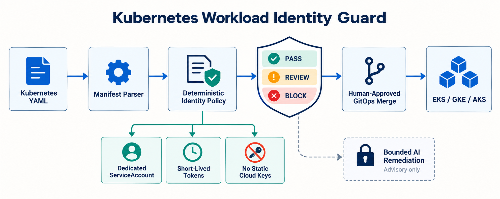

# Kubernetes Workload Identity Guard

A deterministic GitOps policy gate that catches unsafe Kubernetes-to-cloud identity patterns before deployment to EKS, GKE, or AKS. It addresses a production problem common to platform and AI-infrastructure teams: workloads inherit broad node credentials, default service accounts, long-lived secrets, or unbounded tokens because identity intent is scattered across manifests and cloud configuration.



## Why this matters now

Current platform, infrastructure-security, and AI-infrastructure roles repeatedly require Kubernetes, cloud IAM, GitOps, Terraform, identity, and secure multi-cloud operations. Official Kubernetes and managed-cloud guidance converges on dedicated service accounts, short-lived credentials, workload identity federation, and disabling unnecessary token mounts. The detailed evidence and source links are in [`docs/research.md`](docs/research.md).

## What the guard checks

- Every workload declares a dedicated, non-default ServiceAccount.
- The referenced ServiceAccount is present in the review bundle.
- AWS, GCP, or Azure workload-identity evidence is declared.
- Azure workloads include the required Pod opt-in label.
- Kubernetes API token automount is disabled when unnecessary.
- Static cloud credential environment variables are prohibited.
- Host networking and weak projected-token settings require review.
- Decisions are deterministic: `PASS`, `REVIEW`, or `BLOCK`.

AI is deliberately bounded. The report supplies an advisory prompt for explaining findings and drafting a minimal patch, but AI cannot change policy thresholds, create IAM bindings, approve a merge, or deploy.

## Quick start

```bash
python -m venv .venv
source .venv/bin/activate
pip install -e . pytest
pytest
workload-identity-guard samples/compliant-aws.yaml --provider aws --output json
```

Expected result:

```json
{
  "decision": "PASS",
  "score": 100,
  "resources_checked": 1
}
```

## Architecture and workflow

1. Pull-request YAML enters the manifest parser.
2. Workloads are correlated with ServiceAccounts in the same namespace.
3. Deterministic provider-aware rules evaluate identity evidence, token behavior, and static credentials.
4. A machine-readable decision is emitted for CI.
5. Optional AI explains findings without enforcement authority.
6. A human-approved GitOps merge remains the only route to EKS, GKE, or AKS.

## Policy rules

| Rule | Decision | Condition |
| --- | --- | --- |
| WI001 | BLOCK | No explicit ServiceAccount |
| WI002 | BLOCK | Default ServiceAccount used |
| WI003 | BLOCK | Referenced ServiceAccount missing from bundle |
| WI004 | BLOCK | Provider workload-identity evidence missing |
| WI005 | REVIEW | Unnecessary API token automount not disabled |
| WI006 | BLOCK | Azure workload identity opt-in label missing |
| WI007 | REVIEW | Host networking increases metadata exposure risk |
| WI008 | BLOCK | Static cloud credential variable declared |
| WI009 | REVIEW | Projected token has no audience or exceeds one hour |

## Tests and CI

The unit suite covers compliant AWS manifests, default or absent service accounts, missing provider identity, static credentials, token automount, Azure opt-in, host networking, projected-token bounds, and unsupported providers. GitHub Actions installs the package, runs the tests, and validates the compliant sample.

## Deployment, security, and failure modes

Use it read-only in pull requests, begin with review-only adoption, protect policy changes, and retain JSON reports. The guard validates declared Kubernetes evidence; it does not prove that external IAM permissions are least-privileged. Cloud-side trust, subject, audience, resource policy, and permission validation remain required. See [`docs/deployment.md`](docs/deployment.md).

## Measurable outcomes

Track dedicated-service-account coverage, federated-identity adoption, static-key findings, remediation time, false-positive rate, exception count, and identity-related incidents. A practical initial target is 100% identity coverage for production workloads and zero newly introduced static credential variables.

## Trade-offs

- Requiring ServiceAccounts in the same review bundle improves auditability but can block repositories that manage identity centrally.
- Annotation checks are portable evidence, not proof of a correct cloud-side association.
- Fail-closed behavior is safer but should be introduced gradually to avoid migration deadlocks.
- Multi-cloud support increases relevance while keeping provider-specific IAM validation out of scope.

## Interview positioning

Use this project to explain a real platform-security problem, the boundary between Kubernetes and cloud IAM, why enforcement is deterministic, how false positives are managed, and how measurable identity coverage reduces blast radius. It demonstrates Kubernetes manifest analysis, multi-cloud identity concepts, policy-as-code, CI/CD, secure AI boundaries, testing, and operational rollout design.

## Repository layout

```text
src/workload_identity_guard/  deterministic analyzer and CLI
tests/                       unit tests
samples/                     AWS and Azure manifests
policy/                      reviewable policy contract
docs/                        architecture, research, deployment
social/                      Medium, LinkedIn, and email-ready copy
.github/workflows/           CI
```

## License

MIT
