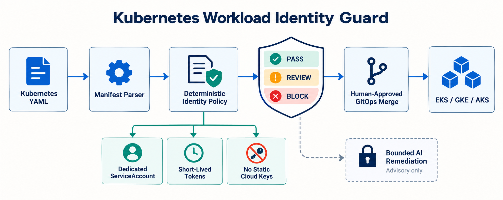

# Enforcing Kubernetes Workload Identity Before GitOps Merge

AI workloads often need access to object storage, queues, model registries, secrets, and telemetry services. The unsafe shortcut is to inherit a node role or mount long-lived cloud credentials. That creates a production risk that ordinary image scanning cannot catch: the workload may be technically deployable while its identity boundary is dangerously broad.

I built **Kubernetes Workload Identity Guard** to evaluate that boundary before GitOps merge.

## Why the problem matters now

Current platform, infrastructure-security, and AI-infrastructure roles consistently combine Kubernetes, cloud IAM, GitOps, Terraform, and secure multi-cloud operations. Official Kubernetes, EKS, and GKE guidance points in the same direction: use dedicated ServiceAccounts, prefer short-lived federated credentials, and disable unnecessary token mounts.

The challenge is that identity intent is split across workload YAML, ServiceAccounts, admission behavior, and provider-side IAM. Reviewers need a deterministic check for what is visible in the pull request without pretending that a static analyzer can prove the entire cloud trust chain.

## Architecture

The guard parses multi-document Kubernetes YAML, correlates each workload with its namespace-scoped ServiceAccount, evaluates provider-aware policy, and emits `PASS`, `REVIEW`, or `BLOCK`. GitOps merge remains human-approved.

AI is a bounded advisory branch. It can explain findings and draft a minimal patch. It cannot change policy thresholds, create cloud IAM bindings, approve, merge, or deploy.

## Implementation choices

The Python engine handles Deployments, StatefulSets, DaemonSets, Jobs, and CronJobs. It checks explicit non-default ServiceAccounts, review-bundle completeness, AWS/GCP/Azure identity markers, Azure Pod opt-in, token automount, host networking, projected-token audience and lifetime, and static credential variables.

The project includes sample manifests, a JSON policy contract, a non-root Docker image, GitHub Actions CI, deployment guidance, and a machine-readable report. It performs no cluster or cloud mutation.

## Tests and validation

The unit suite covers compliant AWS policy, absent and default ServiceAccounts, missing identity evidence, static credentials, unnecessary automount, Azure opt-in, host-network risk, long-lived projected tokens, and unsupported providers. The compliant sample must score 100 and return `PASS` in CI.

## Deployment and operations

Start read-only in pull requests. Measure false positives in `REVIEW` mode, inventory existing provider associations, protect policy changes with code owners, and retain JSON reports. Only then promote deterministic `BLOCK` findings to a required check.

Provider-side validation remains essential: verify trust policies, namespace and subject conditions, token audience, cluster identity, resource policies, and least-privilege permissions. An annotation proves declared intent, not correct cloud IAM.

## Security, privacy, and failure modes

The parser stays local and should never emit secret values. Static credential variable names block even when the value comes from a Kubernetes Secret because the design goal is federation, not secret rotation. Missing identity evidence and unsupported providers fail closed. Admission-webhook mutation and centrally managed ServiceAccounts need explicit integration contracts to avoid false blocks.

## Measurable outcomes

Useful measures include dedicated-ServiceAccount coverage, federated-identity adoption, static-key findings per 100 changes, remediation time, false-positive rate, policy exceptions, and identity-related incidents. The initial objective is simple: no newly introduced static cloud keys and complete identity evidence for production workloads.

## Trade-offs and lessons

Cross-repository identity ownership is common, so demanding every ServiceAccount in the same bundle may require an approved evidence mechanism. Multi-cloud checks improve portability but cannot replace provider-native IAM analysis. Most importantly, AI should help humans understand policy—not own the decision.

## Interview positioning

This project demonstrates Kubernetes internals, cloud IAM boundaries, multi-cloud workload identity, policy-as-code, CI/CD, secure AI integration, testing, and staged platform adoption. The strongest interview story is the design boundary: deterministic rules enforce reviewable facts, cloud IAM remains separately verified, and humans retain production authority.

Repository: https://github.com/ohjeffkuston/kubernetes-workload-identity-guard
